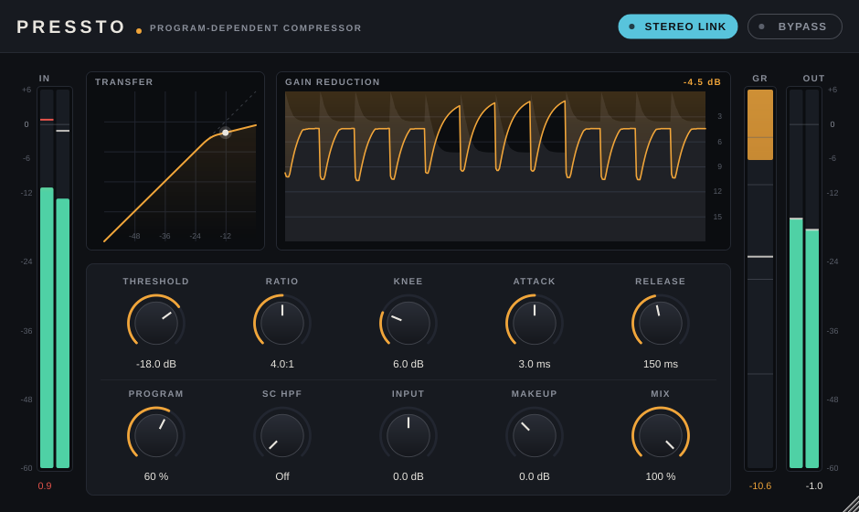

# Pressto Compressor

A transparent, program-dependent compressor plugin (VST3 on every platform, plus AU on macOS and a
Standalone app) built with JUCE 8. Its detector is modelled on the "release to the average program level"
behaviour of the Charter Oak SCL-1. See [docs/DESIGN.md](docs/DESIGN.md) for the analysis and measurements.



## Controls

| Control | What it does |
| --- | --- |
| **Threshold** | Level at which gain reduction starts (-60 to 0 dB). |
| **Ratio** | 1:1 to 20:1. |
| **Knee** | Soft-knee width (0 to 24 dB). Wider is gentler. This is the SCL-1's "static threshold". |
| **Attack** | 0.1 to 50 ms. The SCL-1 range is 0.1 to 5 ms. |
| **Release** | 20 ms to 2 s. How fast gain recovers after a peak. |
| **Program** | Program-dependent release (0 to 100 %). Higher values settle to the average program level instead of releasing fully after every peak. At 0 % it behaves as a plain peak compressor. |
| **SC HPF** | High-pass filter on the detector only (Off, or 20 to 500 Hz). Keeps bass from pumping the mix. |
| **Input** | Gain before the compressor (±24 dB). |
| **Makeup** | Gain after the compressor and mix (-12 to +24 dB). |
| **Mix** | Dry/wet blend for parallel compression. |
| **Stereo Link** | On: both channels share one detector, so the image never shifts. Off: dual mono. Disabled in Mid/Side mode. |
| **Mid/Side** | Stereo tracks only. Compresses the centre (mid) and the stereo width (side) independently, then decodes back to L/R. The GR meter splits into M and S bars. Switching is click-free. |
| **Bypass** | Click-free. Also mapped to the host's bypass. |

Tips:

* Double-click any knob to reset it.
* Click a value to type a new one. Units work, e.g. `1.2 s` or `off`.
* Click a meter to reset its peak hold.
* When channels are compressed independently (Mid/Side, or Stereo Link off), the GR meter shows two bars.
* Drag the bottom-right corner to resize the window (75 % to 200 %).

## Building

Requirements:

* CMake 3.22 or newer, a C++17 compiler, and Git.
* JUCE 8 is fetched automatically. It includes the VST3 SDK, so nothing else needs downloading.
* **Linux:** Ninja and the packages below.

  ```bash
  sudo apt install ninja-build libasound2-dev libfreetype-dev libfontconfig1-dev libx11-dev \
    libxcomposite-dev libxcursor-dev libxext-dev libxinerama-dev libxrandr-dev libxrender-dev
  ```

* **macOS:** Xcode command-line tools, plus Ninja (`brew install ninja`) or use the Xcode preset.
* **Windows:** Visual Studio 2022 or newer, with the "Desktop development with C++" workload.

Run these from the repo root:

```bash
# Linux
cmake --preset linux-release && cmake --build --preset linux-release

# macOS: universal arm64 + x86_64, runs on macOS 10.13+
cmake --preset macos-universal && cmake --build --preset macos-universal
# ...or generate an Xcode project
cmake --preset macos-xcode && cmake --build --preset macos-xcode

# Windows: uses the newest installed Visual Studio
cmake --preset windows-msvc && cmake --build --preset windows-msvc-release
```

Plugins end up in `build/<preset>/pressto/PresstoCompressor_artefacts/<Config>/{VST3,AU,Standalone}`.

To install, copy the plugin to your plugin folder, or configure with `-DPRESSTO_COPY_PLUGIN_AFTER_BUILD=ON`:

| OS | VST3 | AU |
| --- | --- | --- |
| Linux | `~/.vst3/` | n/a |
| macOS | `~/Library/Audio/Plug-Ins/VST3/` | `~/Library/Audio/Plug-Ins/Components/` |
| Windows | `C:\Program Files\Common Files\VST3\` | n/a |

**macOS note:** builds are unsigned. Before loading a plugin on Apple Silicon, ad-hoc sign it. If it came
from a download (for example a CI artifact), also clear the quarantine flag:

```bash
codesign --force --deep --sign - "Pressto Compressor.vst3"
xattr -dr com.apple.quarantine "Pressto Compressor.vst3"
```

### Tests

```bash
ctest --preset linux-release              # on Linux without a display: xvfb-run -a ctest --preset linux-release
```

* `PresstoEngineTests` checks the DSP: static curve, distortion, program-dependent release, stereo link
  and the sidechain filter.
* `PresstoPluginTests` loads the real processor and editor. It checks that every knob and button drives
  the right parameter, and checks bypass, mix, gain, link, mid/side (including click-free switching and
  mono tracks) and state restore. Run it with
  `--snapshot <dir>` to render the editor to PNG.

CI (`.github/workflows/build.yml`) builds on Linux, macOS (universal) and Windows. It runs both test
suites, validates the VST3 (and the AU on macOS) with [pluginval](https://github.com/Tracktion/pluginval)
at strictness level 10, and uploads the plugins as artifacts.

### Options

| CMake option | Default | |
| --- | --- | --- |
| `PRESSTO_JUCE_TAG` | `8.0.15` | JUCE version to fetch |
| `JUCE_SOURCE_DIR` | unset | Use a local JUCE checkout instead of fetching |
| `VST3_SDK_DIR` | unset | Use an external VST3 SDK instead of JUCE's bundled copy |
| `PRESSTO_BUILD_STANDALONE` | `ON` | Also build the Standalone app |
| `PRESSTO_BUILD_TESTS` | `ON` | Build the test executables |
| `PRESSTO_COPY_PLUGIN_AFTER_BUILD` | `OFF` | Copy plugins into the system folders after building |

The devcontainer (`Dockerfile`, Ubuntu 24.04) has all the Linux dependencies preinstalled.

If you configured with the previous build setup, delete `build/` first.

## License note

JUCE 8 is dual-licensed under AGPLv3 and a commercial license. Distributing Pressto binaries requires
complying with one of them.
